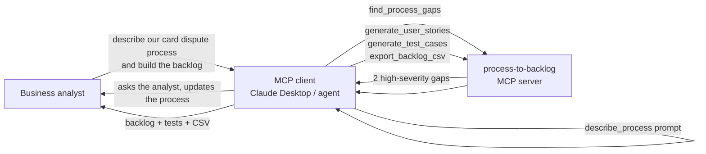

# Process-to-Backlog MCP Server

An **MCP (Model Context Protocol) server** that gives any AI assistant — Claude Desktop, Claude Code, an OpenAI or LangGraph agent — tools to turn a business process into a **delivery backlog**: gap analysis, user stories with acceptance criteria and story points, Given/When/Then test cases, and a Jira-ready CSV.

It automates the step between process discovery and delivery that business analysts usually do by hand in spreadsheets: going from "here is how the process works" to "here is the backlog the team can build".

---

## Why MCP, and why deterministic tools

| Decision | Reason |
|---|---|
| **MCP server, not a chatbot** | One implementation works with every MCP client. The assistant handles the conversation; the server provides reliable, testable capabilities. |
| **Deterministic tools** | The same process input always gives the same backlog, so every story traces back to a step, rule or SLA in the input. The assistant is free to polish the wording, but the structure is auditable. |
| **Gaps first** | `find_process_gaps` flags missing owners, actors, rules, systems and SLAs *before* stories are written, and the server instructions tell the assistant to ask the user about high-severity gaps first. A backlog built on gaps produces rework. |
| **Typed input** | The process is a Pydantic model (`Process → Stage → Step`), so MCP clients receive a JSON schema and invalid input is rejected with a clear error. |

## What the server exposes

| Type | Name | Purpose |
|---|---|---|
| Tool | `find_process_gaps` | Missing owner / actor / rules / systems / SLA, with severity |
| Tool | `generate_user_stories` | One story per step, grouped into one epic per stage, with acceptance criteria and story points |
| Tool | `generate_test_cases` | Positive, negative (per rule), integration-failure (per system) and SLA test cases |
| Tool | `export_backlog_csv` | CSV with Issue Type, Summary, Description, Epic Link, Story Points |
| Tool | `backlog_summary` | Counts of stages, stories, points, tests and gaps |
| Resource | `process://samples/card-dispute` | A sample process to try |
| Prompt | `describe_process` | Asks the model to describe a process in the JSON shape the tools expect |

## How it fits together



## Example (sample card-dispute process)

```
$ python -m backlog_mcp.cli samples/card_dispute.json
{ "stages": 3, "stories": 7, "story_points": 30, "test_cases": 19,
  "gaps": { "high": 2, "medium": 0, "low": 2 } }

GAPS
  [high  ] Intake / Classify fraud or dispute: No actor for a step a person must do
  [high  ] Resolution / Submit chargeback: Integration step without a named system
  ...
STORIES
  US-005 (5 pts) As a Dispute analyst, I want to decide on provisional credit so that
                 the analyst has the evidence needed to decide
      - Rule applied: Up to EUR 2,500 without team-lead approval
      - Rule applied: No credit for accounts under 30 days old
      - The approver can approve, reject or send back with a mandatory comment
      - Step is completed within 10 business days; otherwise it is escalated
```

The sample deliberately contains gaps so you can see the gap analysis work.

## Run it

```bash
git clone https://github.com/RSD161093/process-to-backlog-mcp.git
cd process-to-backlog-mcp
python -m venv .venv && source .venv/bin/activate     # Windows: .venv\Scripts\activate
pip install -r requirements.txt

python -m backlog_mcp.cli samples/card_dispute.json --csv backlog.csv   # without an MCP client
python examples/client_demo.py         # real MCP client over stdio
pytest -q                              # 8 tests
```

### Use it from Claude Desktop

Add this to `claude_desktop_config.json` (use your own paths), then restart Claude Desktop:

```json
{
  "mcpServers": {
    "process-to-backlog": {
      "command": "C:/path/to/process-to-backlog-mcp/.venv/Scripts/python.exe",
      "args": ["-m", "backlog_mcp.server"],
      "cwd": "C:/path/to/process-to-backlog-mcp"
    }
  }
}
```

Then ask: *"Use the card-dispute sample, check it for gaps, then build the backlog and test cases."*

## Project structure

```
backlog_mcp/
  backlog.py   Pydantic process model + gap analysis, stories, tests, CSV (pure functions)
  server.py    MCP server: tools, resource and prompt (MCP Python SDK 2.x)
  cli.py       try the logic without an MCP client
examples/
  client_demo.py   connects over stdio, lists tools, calls one
samples/       fictional card-dispute process
tests/         story, gap, test-case and CSV logic + MCP tool listing and tool call
```

## Ideas to extend it

- A `push_to_jira` tool using the Jira REST API, gated by an explicit user confirmation
- Read process input from BPMN files or Pega Blueprint exports
- Size stories against a team's historical velocity instead of the simple heuristic
- Streamable HTTP transport and OAuth so a whole team can share one server

## Tech stack

Python 3.10+ · MCP Python SDK 2.x (`MCPServer`) · Pydantic v2 · pytest

---

Designed and built by [Rahul Dusane](https://www.linkedin.com/in/rahul-dusane-6a68399b/), Agentic AI Solution Architect with 10+ years in BPM / Pega delivery, where discovery-to-backlog is daily work.
